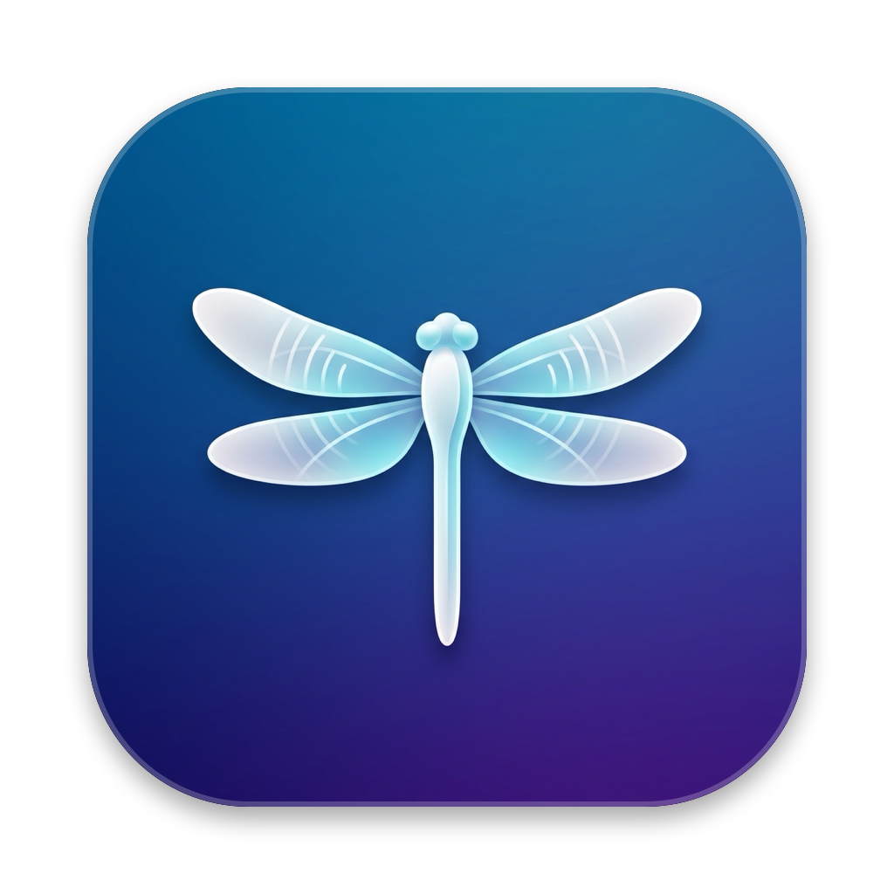

<p align="center">
  
</p>

<h1 align="center">SpikDoum</h1>

<p align="center">
  <strong>실시간 다국어 음성 인식(STT) · 라이브 번역 · 2개 언어 동시 대화 코치 · 요약 · 타임라인 다시 재생 macOS 앱</strong>
</p>

<p align="center">
  <a href="README.md">English</a> | <strong>한국어</strong>
</p>

---

**SpikDoum**은 마이크, Mac 시스템 오디오(유튜브·Google Meet·Zoom), 또는 두 소스를 동시에 들으면서 실시간 음성 인식(STT), 즉시 번역, 2개 언어 동시 AI 대화 코칭, 누적 키워드, 전체/화자별 요약, AI 문단 정리 스크립트, 음성 동기화 다시 재생을 제공하는 네이티브 macOS 앱입니다.

---

## 주요 기능

### 🎙️ 다국어 음성 인식 (STT)
- **언어 자동 인식 & 12개 언어 지정**: **자동 인식**과 12개 지정 언어(영어·한국어·일본어·중국어 간체/번체·스페인어·프랑스어·독일어·포르투갈어·이탈리아어·러시아어·베트남어)를 **듣기 전은 물론 실시간 듣기 중에도 즉시 전환**할 수 있습니다.
- **3가지 STT 엔진 독립 선택**:
  - **앱 내 자체 Whisper 서버 (`whisper.cpp` Metal GPU)**: 무음 경계 / 최대 3초 청킹으로 완전 로컬 추론. 검증된 **9종 Whisper 모델**(`Tiny` ~ `Large v3 Turbo Q5/Q8` ~ `Large v3 Q5`) 원클릭 다운로드 및 **로컬 `.bin` 모델 직접 추가** 지원.
  - **Apple 음성 인식**: 세션 자동 갱신·일시 오류 복구 및 로컬 CAMPPlus 화자 분리(`SpeakerWorker`) 지원.
  - **Deepgram Nova-3**: 다국어 스트리밍 STT 및 `v1` 화자 구분.
- **상황별 오디오 수집 & 추천 프리셋**:
  - **대면 대화(마이크만)**, **유튜브/Mac 소리 전용**(ScreenCaptureKit), **Google Meet**(Chrome/Safari/Edge/Firefox + 마이크), **Zoom**(Zoom 앱 + 마이크).
  - 저장된 블루투스/USB 마이크 연결이 끊겨 있으면 듣기 시작 시 자동으로 시스템 기본 입력 마이크로 폴백합니다.

### 🌐 실시간 번역 & 다국어 UI
- **앱 UI 다국어 즉시 전환**: 재시작 없이 `시스템 기본 / 한국어 / English / 日本語 / 简体中文`으로 UI 언어를 바로 변경할 수 있습니다.
- **한국어 · 영어(EN) · 12개 언어 원클릭 번역 전환**: 번역 패널 상단의 `한국어` / `EN` 버튼 및 12개 언어 메뉴에서 출력 언어를 바꾸면 현재 대화 원문을 새 언어로 즉시 재번역합니다.
- **4가지 번역 엔진**:
  - **Apple 전용 번역**: 온디바이스 저지연(`.lowLatency`) NMT 우선 + 기본 세션 자동 폴백, Whisper 비발화 태그(`[BLANK_AUDIO]`, `(音楽)` 등) 자동 정리.
  - **앱 내 자체 번역 LLM 서버 (`llama.cpp` Metal GPU)**: 검증된 **10종 GGUF 모델**(`Qwen2.5 0.5B/1.5B/3B/7B`, `Qwen3 1.7B/4B`, `Gemma 2 2B`, `Gemma 3 4B/12B`, `Llama 3.2 3B`) 원클릭 다운로드 및 **로컬 `.gguf` 파일 직접 추가** 지원.
  - **Azure Translator**: 문장별 언어 자동 감지 번역.
  - **로컬 LLM · 번역 API**: 사용자 정의 HTTP POST 엔드포인트·요청 JSON 템플릿·응답 경로 설정.

### ✨ 2개 언어 동시 대화 코치 · 요약 · 전체 스크립트
- **STT 언어 + 번역 언어 동시 코칭**: 상대방의 STT 언어(바로 말할 수 있는 표현)와 내 번역 언어(의미·조언 이해)를 한 카드 안에서 배지로 구분해 동시에 제안합니다. **Apple Intelligence (`FoundationModels`)**, **OpenAI API**, **OpenAI 호환 서버**(Ollama / LM Studio / vLLM) 모두 지원합니다.
- **CJK 토큰 예산 자동 관리**: 한국어·일본어·중국어 대화가 길어져도 Apple 온디바이스 모델의 4,096 토큰 창을 초과하지 않도록 가중 토큰 절단 및 자동 축소 재시도를 적용했습니다.
- **누적 키워드**: 최신 키워드가 상단에 오도록 번역 패널과 함께 표시합니다.
- **오른쪽 요약 · 전체 스크립트 패널**: 전체/화자별 누적 요약과 요약 이력, 문장·문단 자동 그룹화, 증분 **AI 문단 정리**(`문단 정리` / `원문+번역` / `번역만` / `원문만`)를 제공합니다.

### 🪟 자유로운 패널 배치 · 메뉴 바 트레이 · 다시 재생
- **패널 위치 이동 & 자동 저장**: `3패널 보기`의 모든 패널(`대화 원문`, `번역`, `대화 코치`, `요약·전체 스크립트`)과 `연결 보기` 좌우 배치를 상단 그립 **드래그 앤 드롭** 또는 **`‹` / `›` 버튼**으로 자유롭게 이동하고, 요약/스크립트 상하 위치도 **`⇅` 버튼**으로 전환할 수 있습니다.
- **듣기 중 실시간 설정 변경**: 듣기가 진행 중일 때도 앱 설정·듣기 설정·모델 관리·트레이 프리셋을 열어서 변경할 수 있습니다. 번역/LLM/화면 설정은 무중단 즉시 반영되고, 마이크/STT 엔진/프리셋 변경은 250ms 디바운스로 현재 대화를 유지한 채 자동 재연결됩니다.
- **macOS 오른쪽 메뉴 바 잠자리 트레이**: 창을 닫아도 트레이에서 빠르게 듣기 시작/중지, 새 대화, 언어·프리셋 전환, 최근 대화 열기, Mac 로그인 시 자동 실행(`SMAppService`)을 제어할 수 있습니다.
- **원본 음성 녹음 & 타임라인 다시 재생 (`⌘R`)**: 대화 중 마이크+시스템 오디오를 로컬 `.m4a`로 녹음하고, 재생 시점에 맞춰 원문·번역·키워드·조언·요약을 동기화해 복기할 수 있습니다.

---

## 시스템 요구 사항

- **Apple Silicon Mac (`arm64`)**
- **macOS 26.0 이상**, **Xcode 26 이상** (소스 빌드 시)
- *(선택)* 내장 런타임(`SpeakerWorker`, `whisper-server`, `llama-server`)을 처음부터 다시 빌드할 경우 Python 3.9+ 및 CMake

---

## 빌드 및 실행

### 1. 로컬 코드 서명 인증서 1회 설정 (권장)
리빌드할 때마다 macOS 마이크·음성 인식·화면 및 시스템 오디오 권한이 초기화되지 않도록 로컬 `"SpikDoum Dev"` 인증서를 생성·신뢰 등록합니다.

```zsh
./scripts/setup-signing.sh
```

### 2. 전체 앱 번들 빌드
`SpeakerWorker`, Metal 지원 `whisper-server` / `llama-server`, Release 바이너리를 묶어 `dist/SpikDoum.app`을 생성하고 서명합니다.

```zsh
./scripts/build-app.sh
open dist/SpikDoum.app
```

### 3. 빠른 증분 리빌드 (Swift 코드 수정 후)

```zsh
./scripts/quick-rebuild.sh
```

### 4. 배포용 DMG 생성

```zsh
./scripts/build-dmg.sh
```

---

## 다른 사용자 Mac에 설치하기

`dist/SpikDoum.app` (약 185 MB)은 Homebrew나 외부 Python 설치 없이 독립 실행됩니다.

- **지원 환경**: **Apple Silicon (`arm64`) + macOS 26.0 이상**
- **Apple 유료 공증 없이 개인/지인 Mac에 설치하는 방법**:
  1. `SpikDoum.app`을 `/Applications` 폴더로 복사합니다.
  2. 받는 Mac의 터미널에서 최초 1회 Gatekeeper 격리 속성을 해제합니다:
     ```zsh
     xattr -dr com.apple.quarantine /Applications/SpikDoum.app
     ```
     *(또는 첫 실행 차단 시 `시스템 설정 → 개인정보 보호 및 보안 → 그래도 열기` 선택)*
  3. 첫 실행 시 **마이크 · 음성 인식 · 화면 및 시스템 오디오 기록** 권한을 허용합니다.
  4. 자체 Whisper/GGUF 모델을 사용하려면 앱 내 **`모델 · 서버 관리`**에서 원하는 모델을 다운로드합니다.
- **경고 없는 정식 배포**: Apple Developer Program의 `Developer ID Application` 인증서(`SPIKDOUM_SIGN_IDENTITY`)로 Hardened Runtime 서명 후 `xcrun notarytool`로 공증해 배포합니다.

---

## 앱 내 단축키

| 단축키 | 동작 |
| :--- | :--- |
| `⌘N` | 새 대화 (옵션 켜짐 시 즉시 듣기 시작) |
| `⌘Return` | 지금 조언 받기 |
| `⌘.` | 듣기 중지 |
| `Space` | 읽기 고정 ↔ 최신으로 이동 전환 |
| `⌘R` | 대화 다시 재생 열기 |
| `⌘E` | Markdown(`.md`)으로 내보내기 |

---

## 개인정보 및 로컬 저장

- 대화 원문·번역·조언·키워드·요약 및 선택적 `.m4a` 녹음 파일은 `~/Library/Application Support/SpikDoum/`에 로컬 저장됩니다.
- 다운로드하거나 직접 추가한 모델은 `~/Library/Application Support/SpikDoum/ManagedModels/`에 보관됩니다.
- 외부 API 키(OpenAI, Deepgram, Azure, 로컬 서버)는 macOS 키체인(`dev.spikdoum.api`)에 안전하게 보관됩니다.
- 앱 내 자체 `whisper-server`(`127.0.0.1:18880`)와 `llama-server`(`127.0.0.1:18881`)는 루프백 주소에만 바인딩하며 실행마다 새 Bearer 인증 토큰과 부모 프로세스 종료 감지 가드를 적용합니다.
- 대화를 기록·전사하기 전 상대방에게 수집 사실을 알린 뒤 사용하세요.

---

## 테스트

```zsh
swift test
```

STT 정책, 번역 묶음·언어 전환 재번역, Whisper 노이즈 정리, CJK 토큰 예산, 2개 언어 코치 파싱, 패널 순서 저장, 대화 저장·검색·다시 재생·내보내기, 검증된 19종 모델 카탈로그 및 로컬 모델 추가까지 **총 88개 단위 테스트**를 실행합니다.

실제 모델 다운로드·추론 통합 테스트:

```zsh
SPIKDOUM_MANAGED_E2E=1 swift test --filter managedRuntimeDownloadsTranscribesTranslatesAndRestarts
```

---

## 프로젝트 구조

```text
.
├── Package.swift                 # SwiftPM 패키지 정의 (macOS 26, SpikDoum + SpikDoumTests)
├── Sources/SpikDoum/             # SwiftUI UI, 오디오 수집, STT, 번역, 코칭, 다시 재생
├── Tests/SpikDoumTests/          # 88개 Swift Testing 단위 테스트
├── Resources/                    # Info.plist, AppIcon.icns/.png, ManagedRuntimeNotice.md
├── worker/                       # Python sherpa-onnx 화자 분리 워커
└── scripts/                      # 앱 빌드, 코드 서명, 네이티브 런타임, 워커, DMG 스크립트
```
