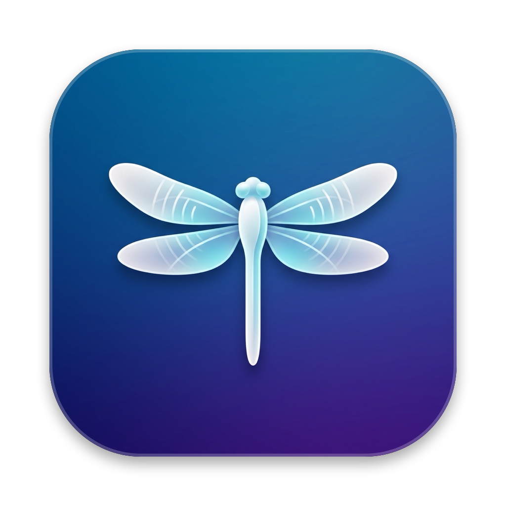

<p align="center">
  
</p>

<h1 align="center">SpikDoum</h1>

<p align="center">
  <strong>Real-time multilingual STT, live translation, bilingual AI conversation coaching, summaries, and time-synced replay for macOS</strong>
</p>

<p align="center">
  <strong>English</strong> | <a href="README.ko.md">한국어</a>
</p>

---

**SpikDoum** is a native macOS app built with SwiftUI that listens to live conversations—via microphone, system audio (YouTube, Google Meet, Zoom), or both simultaneously—and delivers real-time speech-to-text (STT), live translation, bilingual AI coaching, accumulated keywords, structured summaries, AI-polished scripts, and synchronized audio replay.

---

## Highlights

### 🎙️ Speech Recognition (STT)
- **Auto-Detect or Specific Language (12 Languages)**: Switch seamlessly between **Auto-Detect** and 12 languages (`en-US`, `ko-KR`, `ja-JP`, `zh-CN`, `zh-TW`, `es-ES`, `fr-FR`, `de-DE`, `pt-BR`, `it-IT`, `ru-RU`, `vi-VN`)—even **while live listening is active**.
- **3 Independent STT Engines**:
  - **Bundled Managed Whisper (`whisper.cpp` Metal GPU)**: Runs 100% locally with silence-boundary / 3s chunking and 9 verified downloadable models (`Tiny` → `Large v3 Turbo Q5/Q8` → `Large v3 Q5`), plus custom local `.bin` model import.
  - **Apple Speech Recognition**: On-device/Apple speech with resilient session rotation, transient error recovery, and local CAMPPlus speaker diarization (`SpeakerWorker`).
  - **Deepgram Nova-3**: Streaming multilingual STT with `v1` diarization.
- **Flexible Audio Capture & Presets**:
  - **In-Person (Mic only)**, **YouTube / Mac Audio Only** (ScreenCaptureKit), **Google Meet** (Chrome / Safari / Edge / Firefox + Mic), and **Zoom** (Zoom App + Mic).
  - Automatic fallback to the system default microphone if a previously saved Bluetooth/USB mic is disconnected.

### 🌐 Real-Time Translation & Multilingual UI
- **Live UI Localization**: Instant in-app UI language switching (`System Default`, `한국어`, `English`, `日本語`, `简体中文`) with no restart required.
- **One-Click Korean / English / 12-Language Translation**: Switch translation output language directly in the Translation panel (`한국어` / `EN` / 12 languages) with automatic re-translation of the current conversation.
- **4 Translation Engines**:
  - **Apple Translation**: On-device translation with low-latency NMT priority and automatic fallback.
  - **Bundled Managed Local LLM (`llama.cpp` Metal GPU)**: 10 verified downloadable GGUF models (`Qwen2.5 0.5B/1.5B/3B/7B`, `Qwen3 1.7B/4B`, `Gemma 2 2B`, `Gemma 3 4B/12B`, `Llama 3.2 3B`) + custom local `.gguf` import.
  - **Azure Translator**: Automatic source-language detection.
  - **Custom Local Translation API**: Configurable POST endpoint, JSON template, and response path.

### ✨ Bilingual Conversation Coach, Summary & Full Script
- **Simultaneous Bilingual Coaching**: Generates suggested replies and actionable advice in **both the STT spoken language and your translation language** at the same time (e.g., `English + Korean` or `Japanese + Korean`), powered by **Apple Intelligence (`FoundationModels`)**, **OpenAI API**, or any **OpenAI-compatible server** (Ollama / LM Studio / vLLM).
- **CJK-Aware Context Budgeting**: Automatically fits long Korean/Japanese/Chinese conversations safely inside Apple FoundationModels' 4,096-token context window with automatic overflow retry.
- **Accumulated Keywords**: Newest-first keyword cards extracted alongside translations.
- **Right-Side Summary & Full Script Panel**: Cumulative overall/per-speaker summaries with history, paragraph-grouped transcripts, and incremental **AI Paragraph Polishing** (`문단 정리` / `원문+번역` / `번역만` / `원문만`).

### 🪟 Customizable Workspace, Tray & Replay
- **Movable Drag-and-Drop Panels**: Reorder all workspace panels (`STT`, `Translation`, `Coach`, `Summary & Script`) by dragging their top handle bar or clicking `‹` / `›`, flip Summary/Script vertically (`⇅`), and persist layout automatically.
- **Change Settings While Listening**: Open App Settings, Capture Settings, Model Manager, or Tray Presets during an active session—translation/LLM changes apply immediately without stopping STT, while mic/STT engine changes coalesce and reconnect automatically.
- **macOS Menu Bar Tray**: Quick dragonfly tray icon on the right menu bar for instant Start/Stop, New Conversation, language & preset switching, recent chats, and Launch at Login (`SMAppService`).
- **Full Audio Recording & Time-Synced Replay**: Optional dual-source AAC (`.m4a`) recording stored locally per conversation with timeline scrubbing (`⌘R`) that replays STT, translations, keywords, advice, and summaries in sync with audio.

---

## Requirements

- **Apple Silicon Mac (`arm64`)**
- **macOS 26.0+** and **Xcode 26+** (for building from source)
- *(Optional)* Python 3.9+ and CMake if rebuilding the bundled `SpeakerWorker` or `whisper-server` / `llama-server` runtimes from scratch

---

## Build & Run

### 1. One-Time Local Code Signing Setup (Recommended)
Creates and trusts a local `"SpikDoum Dev"` signing certificate so macOS Microphone, Speech Recognition, and Screen & System Audio permissions persist across rebuilds:

```zsh
./scripts/setup-signing.sh
```

### 2. Full App Bundle Build
Builds `SpeakerWorker`, Metal-enabled `whisper-server` / `llama-server`, compiles the release Swift binary, bundles `dist/SpikDoum.app`, and signs it:

```zsh
./scripts/build-app.sh
open dist/SpikDoum.app
```

### 3. Fast Incremental Rebuild (After Swift Code Changes)

```zsh
./scripts/quick-rebuild.sh
```

### 4. Create Distributable DMG

```zsh
./scripts/build-dmg.sh
```

---

## Installing on Another Mac

`dist/SpikDoum.app` (~185 MB) is self-contained with zero Homebrew or external Python dependencies.

- **Supported targets**: Apple Silicon (`arm64`) Macs running **macOS 26.0+**.
- **Without Apple Notarization (personal / team sharing)**:
  1. Copy `SpikDoum.app` into `/Applications`.
  2. Remove the macOS Gatekeeper quarantine flag once:
     ```zsh
     xattr -dr com.apple.quarantine /Applications/SpikDoum.app
     ```
  3. Grant **Microphone**, **Speech Recognition**, and **Screen & System Audio Recording** permissions on first launch.
  4. Download desired Whisper / GGUF models inside **Models & Servers** (`모델 · 서버 관리`).
- **Public distribution without Gatekeeper prompts**: Sign with an Apple Developer Program `Developer ID Application` certificate (`SPIKDOUM_SIGN_IDENTITY="Developer ID Application: ..."`), enable Hardened Runtime, and notarize with `xcrun notarytool`.

---

## Keyboard Shortcuts (In-App)

| Shortcut | Action |
| :--- | :--- |
| `⌘N` | New conversation (optional auto-start listening) |
| `⌘Return` | Request Coach advice immediately |
| `⌘.` | Stop listening |
| `Space` | Toggle Freeze View (`읽기 고정`) ↔ Jump to Live |
| `⌘R` | Open Time-Synced Replay |
| `⌘E` | Export conversation to Markdown (`.md`) |

---

## Privacy & Local Storage

- Conversations, summaries, keywords, and optional `.m4a` recordings are stored locally in `~/Library/Application Support/SpikDoum/`.
- Downloaded and custom-imported models are stored in `~/Library/Application Support/SpikDoum/ManagedModels/`.
- API keys (OpenAI, Deepgram, Azure, Local Server) are stored in the macOS Keychain (`dev.spikdoum.api`).
- Managed local `whisper-server` (`127.0.0.1:18880`) and `llama-server` (`127.0.0.1:18881`) bind strictly to loopback with a per-launch random bearer token and parent-process lifetime guard.
- Always inform participants before recording or transcribing a conversation.

---

## Testing

```zsh
swift test
```

Runs **88 unit tests** covering STT policies, translation batching/re-translation, Whisper noise cleanup, CJK token budgeting, bilingual coach parsing, panel layout persistence, conversation storage/replay/export, and verified model catalog integrity.

Optional full end-to-end managed model test (downloads & runs real Whisper + Qwen inference):

```zsh
SPIKDOUM_MANAGED_E2E=1 swift test --filter managedRuntimeDownloadsTranscribesTranslatesAndRestarts
```

---

## Project Structure

```text
.
├── Package.swift                 # SwiftPM manifest (macOS 26, SpikDoum + SpikDoumTests)
├── Sources/SpikDoum/             # SwiftUI app, audio capture, STT, translation, coaching, replay
├── Tests/SpikDoumTests/          # 88 Swift Testing unit tests
├── Resources/                    # Info.plist, AppIcon.icns/.png, ManagedRuntimeNotice.md
├── worker/                       # Python sherpa-onnx speaker diarization worker
└── scripts/                      # Build, signing, runtime, worker, and DMG scripts
```
